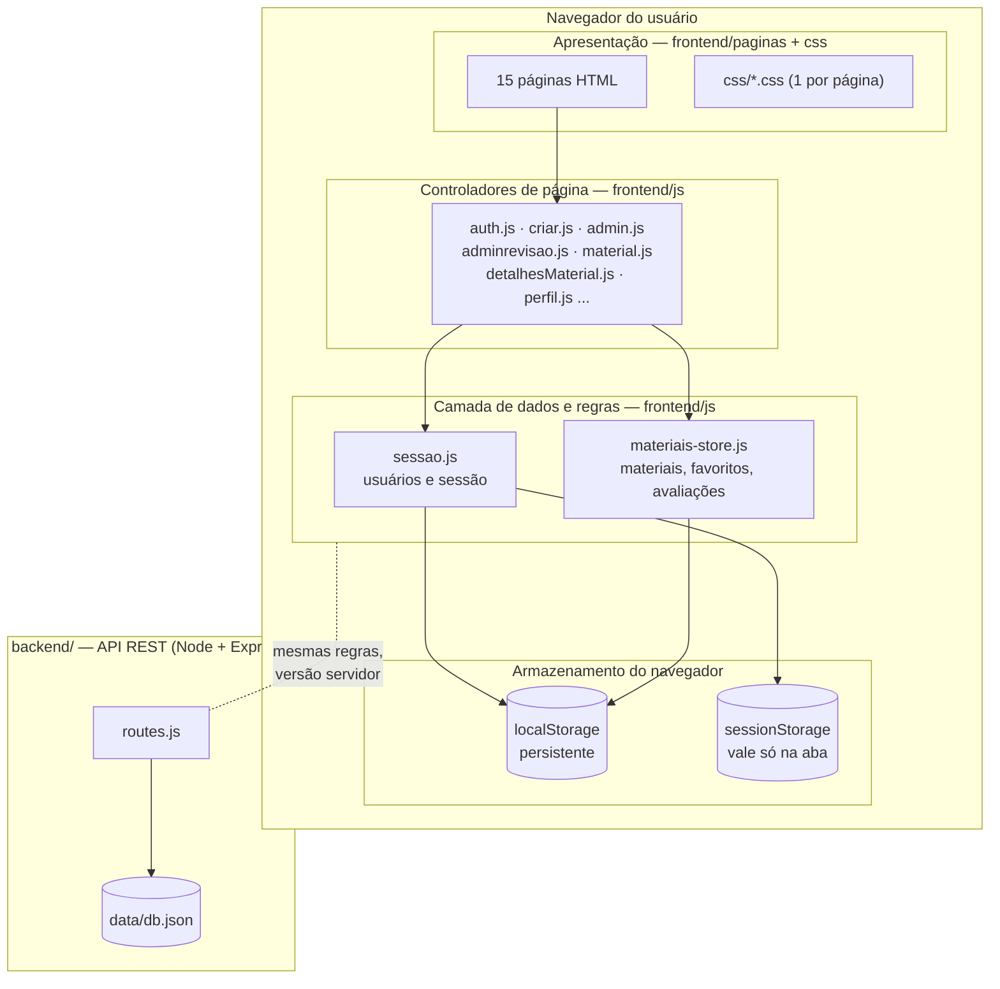
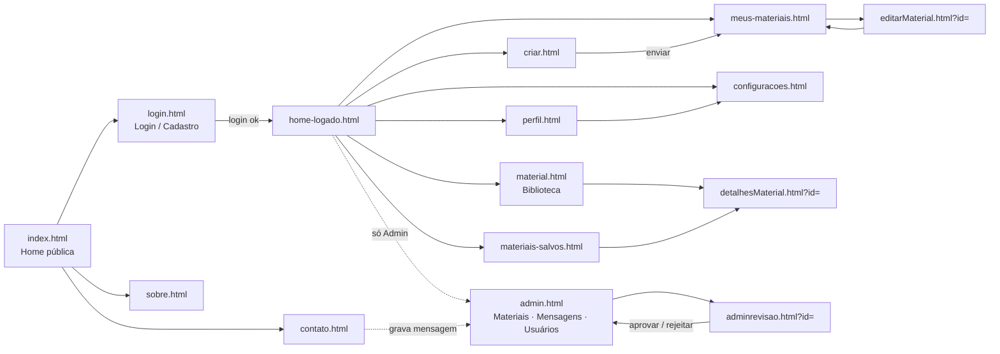
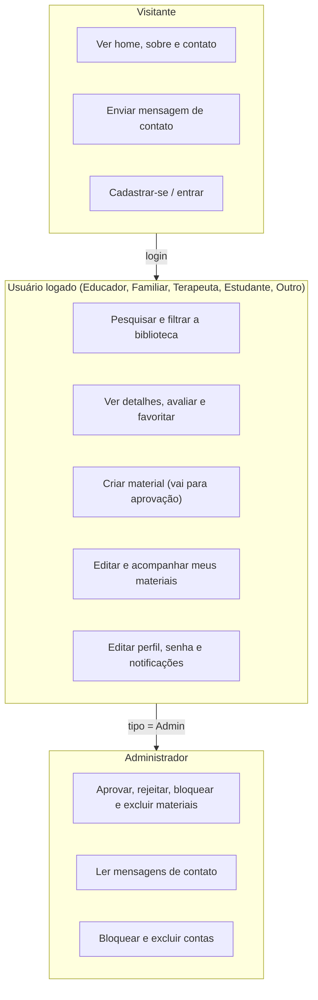
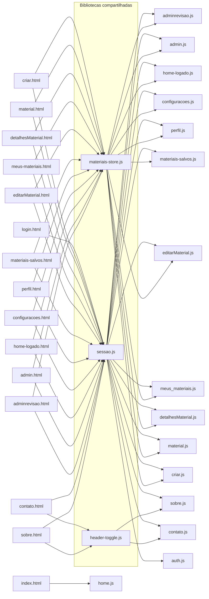
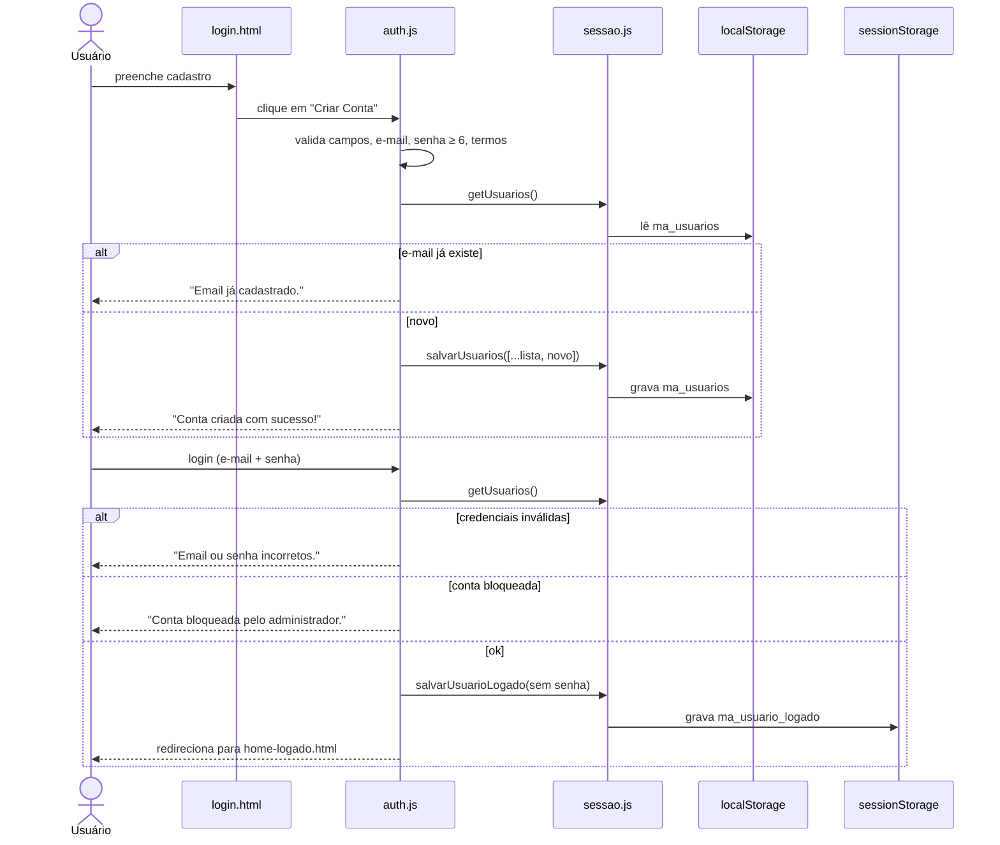
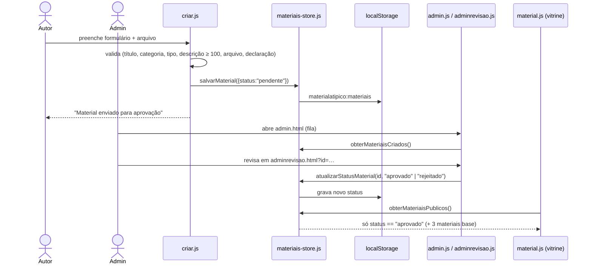
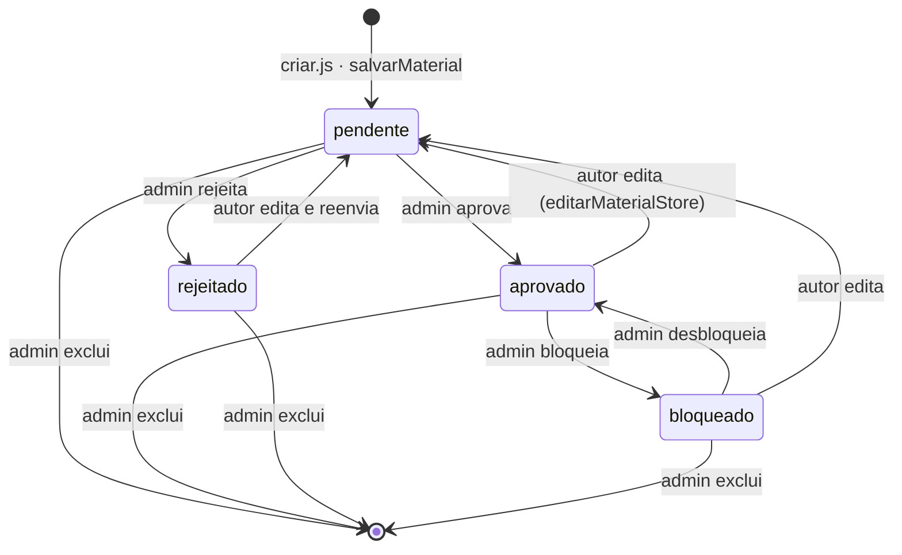
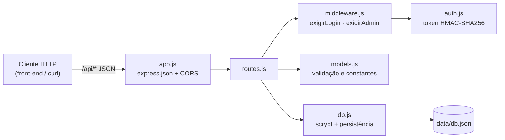

# Arquitetura — Material Atípico

Todos os diagramas abaixo são [Mermaid](https://mermaid.js.org/) e são renderizados automaticamente pelo GitHub.

## 1. Visão geral (camadas)

O sistema é uma aplicação web **multipágina estática**. Não há servidor na versão entregue: o navegador executa HTML + CSS + JavaScript puro e a persistência fica no `localStorage` / `sessionStorage`. A camada de dados (`sessao.js` + `materiais-store.js`) concentra todas as regras de negócio e é o único código que toca o storage — por isso foi possível escrever o `backend/` como um espelho 1:1 dessas regras.

## 2. Mapa de navegação (páginas)

## 3. Casos de uso

O usuário logado também realiza tudo o que o visitante faz, e o administrador também realiza tudo o que o usuário logado faz.

## 4. Dependência de scripts por página

Cada página carrega **sempre** `sessao.js` primeiro; páginas que manipulam materiais carregam também `materiais-store.js`; por fim, o controlador próprio.

## 5. Sequência — cadastro e login

## 6. Sequência — do envio à publicação de um material

## 7. Máquina de estados do material

## 8. Arquitetura do `backend/`

A API não é consumida pelo front-end atual (que usa o localStorage), mas implementa as mesmas regras e pode substituir o `materiais-store.js` / `sessao.js` quando o projeto evoluir.

### Endpoints

| Grupo | Método e rota | Acesso | Equivalente no front-end |
|---|---|---|---|
| Auth | `POST /api/auth/cadastro` · `POST /api/auth/login` | público | `auth.js` |
| Perfil | `GET/PATCH /api/me` · `PUT /api/me/senha` | logado | `configuracoes.js`, `perfil.js` |
| Materiais | `GET /api/materiais` (aprovados; `?categoria=&tipo=&q=`) | público | `obterMateriaisPublicos` |
| | `GET /api/materiais?meus=true` | logado | `obterMateriaisPorAutor` |
| | `GET /api/materiais/:id` | público se aprovado; dono/admin nos demais | `obterMaterialPorId` |
| | `POST /api/materiais` (entra como `pendente`) | logado | `criar.js` |
| | `PUT /api/materiais/:id` (volta a `pendente`) | dono ou admin | `editarMaterialStore` |
| | `PATCH /api/materiais/:id/status` · `DELETE /api/materiais/:id` | admin | `atualizarStatusMaterial`, `excluirMaterial` |
| Favoritos | `GET /api/favoritos` · `POST /api/favoritos/:id` (alterna) | logado | `alternarFavorito` |
| Avaliações | `GET /api/materiais/:id/avaliacoes` | público | `obterResumoAvaliacoes` |
| | `PUT /api/materiais/:id/avaliacoes` (1 por usuário) | logado | `salvarAvaliacao` |
| Contato | `POST /api/contato` | público | `contato.js` |
| Admin | `GET /api/admin/materiais` · `GET /api/admin/mensagens` · `PATCH /api/admin/mensagens/:id/lida` | admin | `admin.js` |
| | `GET /api/admin/usuarios` · `PATCH …/:email/bloqueio` · `DELETE …/:email` | admin | `admin.js` (aba Usuários) |
