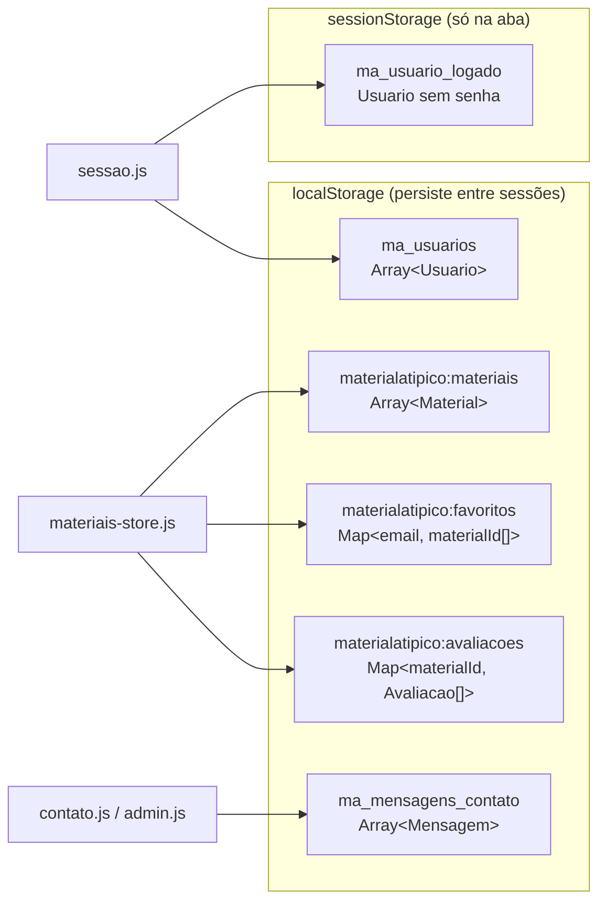
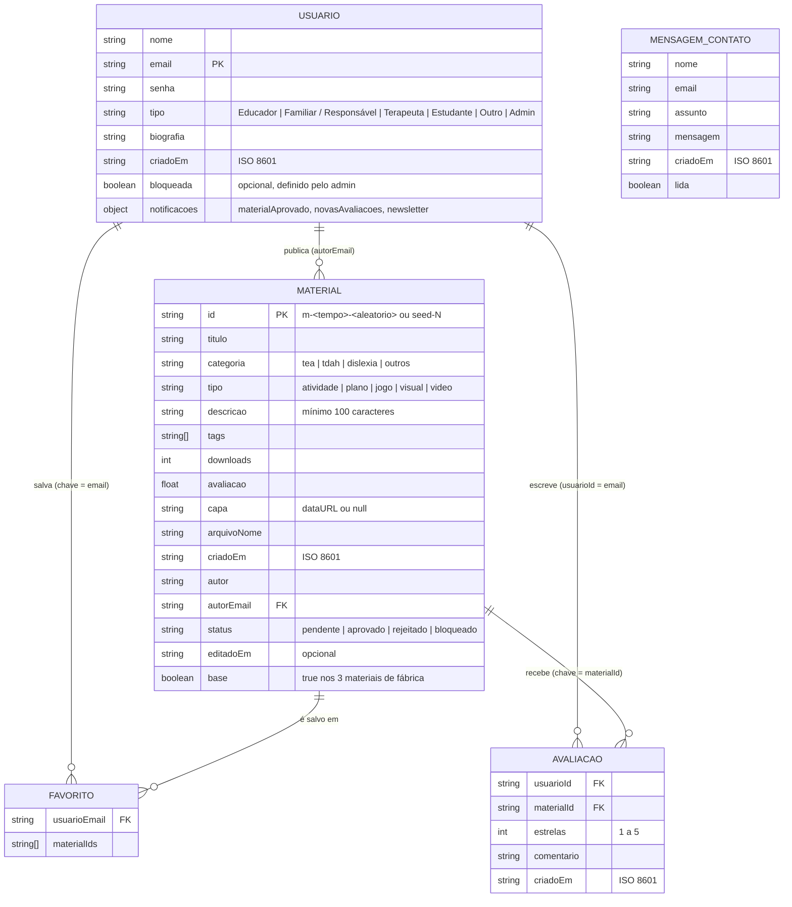
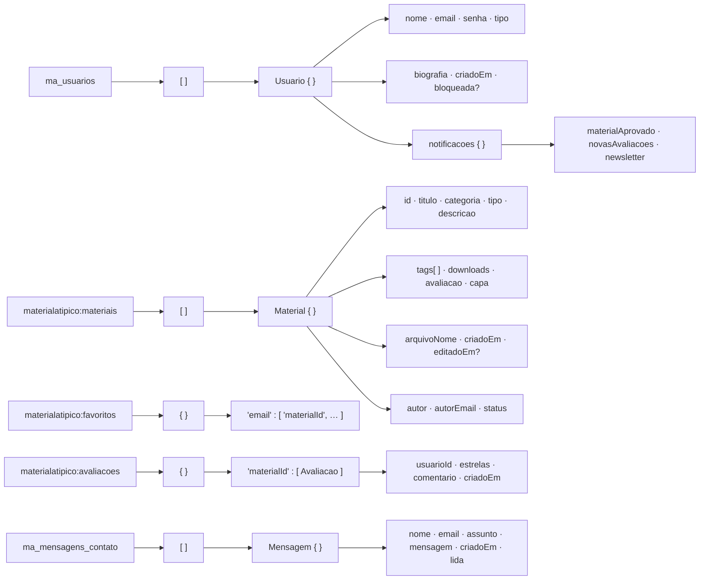

# Estrutura dos dados (JSON)

A aplicação guarda **cinco coleções no `localStorage`** e **um objeto no `sessionStorage`**. Os exemplos abaixo foram extraídos do próprio navegador com a aplicação rodando (arquivos completos em [`docs/json/`](json/)). O arquivo original `frontend/data/usuarios.json` documenta apenas a estrutura de usuário.

## 1. Mapa das chaves de armazenamento



## 2. Modelo de entidades e relacionamentos

As relações são lógicas (por **e-mail** e por **id**), pois o storage não tem chave estrangeira.



## 3. Estrutura do JSON de cada chave (visão em árvore)



## 4. Exemplos reais

### `ma_usuarios` — [`docs/json/ma_usuarios.json`](json/ma_usuarios.json)
Escrito por `sessao.js` (`seedAdmin`), `auth.js` (cadastro), `configuracoes.js` e `admin.js` (bloqueio / exclusão). A conta `admin@materialatipico.com` é criada automaticamente na primeira visita.
```json
[
  {
    "nome": "Administrador",
    "email": "admin@materialatipico.com",
    "senha": "admin123",
    "tipo": "Admin",
    "biografia": "Conta de administração da plataforma.",
    "criadoEm": "2026-11-23T20:10:00.000Z",
    "notificacoes": {
      "materialAprovado": true,
      "novasAvaliacoes": true,
      "newsletter": false
    }
  },
  {
    "nome": "Maria Silva",
    "email": "maria.silva@email.com",
    "senha": "senha123",
    "tipo": "Educador",
    "biografia": "",
    "criadoEm": "2026-11-23T20:10:00.000Z",
    "notificacoes": {
      "materialAprovado": true,
      "novasAvaliacoes": true,
      "newsletter": false
    }
  }
]
```

### `ma_usuario_logado` (sessionStorage) — [`docs/json/ma_usuario_logado.sessionStorage.json`](json/ma_usuario_logado.sessionStorage.json)
Cópia do usuário **sem a senha**, gravada por `auth.js` no login e removida em `logout()`.
```json
{
  "nome": "Maria Silva",
  "email": "maria.silva@email.com",
  "tipo": "Educador",
  "biografia": "",
  "criadoEm": "2026-11-23T20:10:00.000Z",
  "notificacoes": {
    "materialAprovado": true,
    "novasAvaliacoes": true,
    "newsletter": false
  }
}
```

### `materialatipico:materiais` — [`docs/json/materialatipico_materiais.json`](json/materialatipico_materiais.json)
Escrito por `criar.js`, `editarMaterial.js` e `admin*.js`. Somente materiais criados por usuários ficam aqui; os 3 materiais de fábrica (`seed-1..3`) estão fixos em `materiais-store.js` (`MATERIAIS_BASE`).
```json
[
  {
    "id": "m-lx2k9a-4fz8qd",
    "titulo": "Rotina Visual com Pictogramas",
    "categoria": "tea",
    "tipo": "visual",
    "descricao": "Material elaborado e testado em sala de aula, com instruções claras para educadores e familiares.",
    "tags": [],
    "downloads": 0,
    "avaliacao": 0,
    "capa": null,
    "arquivoNome": "rotina-visual.pdf",
    "criadoEm": "2026-11-23T20:15:00.000Z",
    "autor": "Maria Silva",
    "autorEmail": "maria.silva@email.com",
    "status": "pendente"
  }
]
```

### `materialatipico:favoritos` — [`docs/json/materialatipico_favoritos.json`](json/materialatipico_favoritos.json)
```json
{
  "maria.silva@email.com": [
    "seed-1"
  ]
}
```

### `materialatipico:avaliacoes` — [`docs/json/materialatipico_avaliacoes.json`](json/materialatipico_avaliacoes.json)
Um usuário tem no máximo uma avaliação por material (a nova substitui a antiga).
```json
{
  "seed-1": [
    {
      "usuarioId": "maria.silva@email.com",
      "estrelas": 5,
      "comentario": "Excelente material!",
      "criadoEm": "2026-11-23T20:16:00.000Z"
    }
  ]
}
```

### `ma_mensagens_contato` — [`docs/json/ma_mensagens_contato.json`](json/ma_mensagens_contato.json)
```json
[
  {
    "nome": "Carlos Souza",
    "email": "carlos@email.com",
    "assunto": "",
    "mensagem": "Quero colaborar com materiais para TDAH.",
    "criadoEm": "2026-11-23T20:05:00.000Z",
    "lida": false
  }
]
```

## 5. Diferenças entre o JSON do navegador e o do `backend/`

| Aspecto | Front-end (localStorage) | Back-end (`data/db.json`) |
|---|---|---|
| Senha | texto puro | hash `scrypt` com salt (`salt:hash`) |
| Usuários | `ma_usuarios[]` | `usuarios[]` (+ campo `bloqueada` sempre presente) |
| Materiais | `materialatipico:materiais[]` | `materiais[]` |
| Favoritos / avaliações | mesmos mapas | `favoritos{}` e `avaliacoes{}` com a mesma forma |
| Mensagens | sem `id` | com `id` (`c-…`), usado em `PATCH /admin/mensagens/:id/lida` |
| Sessão | `sessionStorage` | token `Bearer` assinado (HMAC-SHA256, 8 h) |
