# Telas da aplicação

Capturas feitas com a aplicação rodando (`1366 px` de largura) usando o fluxo real: cadastro → login → criação de material → login como administrador. Cada tela lista os arquivos que a implementam (HTML, CSS e JS). Todas carregam também os estilos globais [`css/style.css`](../frontend/css/style.css) e, as logadas, [`css/home-logado.css`](../frontend/css/home-logado.css).

> Credencial de administrador de demonstração: `admin@materialatipico.com` / `admin123` (criada por `seedAdmin()` em [`js/sessao.js`](../frontend/js/sessao.js)).

| # | Tela | Página |
|---|---|---|
| 01 | [Home pública](#01-home-publica) | `index.html` |
| 02 | [Sobre nós](#02-sobre) | `paginas/sobre.html` |
| 03 | [Contato](#03-contato) | `paginas/contato.html` |
| 04 | [Login](#04-login) | `paginas/login.html` |
| 05 | [Cadastro](#05-cadastro) | `paginas/login.html` |
| 06 | [Home do usuário logado](#06-home-logado) | `paginas/home-logado.html` |
| 07 | [Biblioteca de materiais](#07-biblioteca-materiais) | `paginas/material.html` |
| 08 | [Detalhes do material](#08-detalhes-material) | `paginas/detalhesMaterial.html` |
| 09 | [Criar material](#09-criar-material) | `paginas/criar.html` |
| 10 | [Meus materiais](#10-meus-materiais) | `paginas/meus-materiais.html` |
| 11 | [Editar material](#11-editar-material) | `paginas/editarMaterial.html` |
| 12 | [Perfil](#12-perfil) | `paginas/perfil.html` |
| 13 | [Materiais salvos](#13-materiais-salvos) | `paginas/materiais-salvos.html` |
| 14 | [Configurações da conta](#14-configuracoes) | `paginas/configuracoes.html` |
| 15 | [Painel admin — Materiais](#15-admin-materiais) | `paginas/admin.html` |
| 16 | [Painel admin — Mensagens](#16-admin-mensagens) | `paginas/admin.html` |
| 17 | [Painel admin — Usuários](#17-admin-usuarios) | `paginas/admin.html` |
| 18 | [Revisão de material (admin)](#18-admin-revisao) | `paginas/adminrevisao.html` |

## 1. Home pública

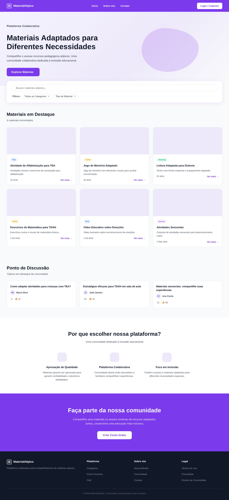

Página inicial para visitantes: apresentação da plataforma, busca por texto, filtros por categoria/tipo, materiais em destaque, posts de discussão e chamada para cadastro. A busca e os filtros atuam sobre os cards já renderizados.

**Código:** [`index.html`](../frontend/index.html) · [`css/style.css`](../frontend/css/style.css) · [`css/home.css`](../frontend/css/home.css) · [`js/home.js`](../frontend/js/home.js)

---

## 2. Sobre nós

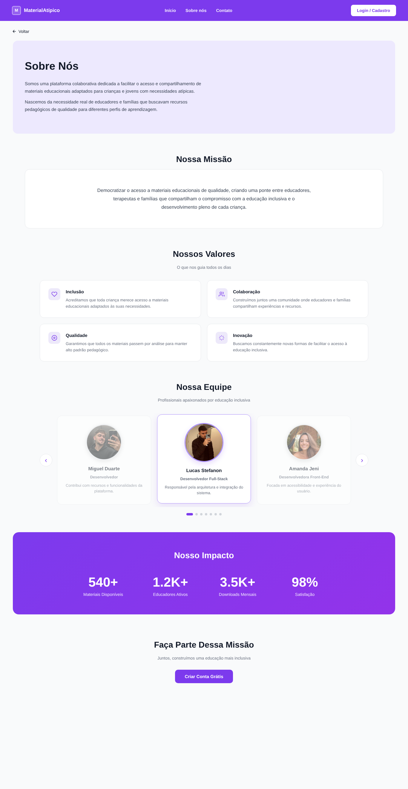

Missão, valores, carrossel da equipe (7 integrantes, com links de GitHub), números de impacto e chamada final.

**Código:** [`paginas/sobre.html`](../frontend/paginas/sobre.html) · [`css/sobre.css`](../frontend/css/sobre.css) · [`js/sobre.js`](../frontend/js/sobre.js) · [`js/header-toggle.js`](../frontend/js/header-toggle.js)

---

## 3. Contato

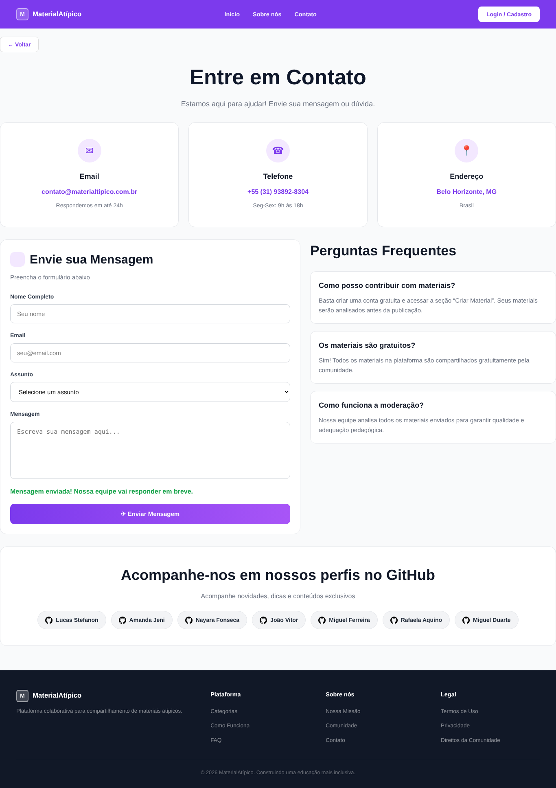

Formulário de contato (nome, e-mail, assunto, mensagem), FAQ e perfis do GitHub da equipe. Ao enviar, a mensagem é gravada em `ma_mensagens_contato` e aparece na aba **Mensagens** do painel admin. A captura mostra o aviso verde de sucesso.

**Código:** [`paginas/contato.html`](../frontend/paginas/contato.html) · [`css/contato.css`](../frontend/css/contato.css) · [`js/contato.js`](../frontend/js/contato.js)

---

## 4. Login

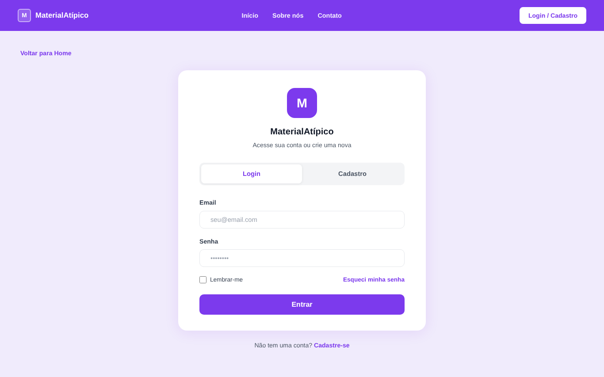

Aba **Login**: valida e-mail/senha contra `ma_usuarios`, recusa contas bloqueadas e, em caso de sucesso, grava o usuário (sem senha) no `sessionStorage` e redireciona para a home logada.

**Código:** [`paginas/login.html`](../frontend/paginas/login.html) · [`css/login.css`](../frontend/css/login.css) · [`js/sessao.js`](../frontend/js/sessao.js) · [`js/auth.js`](../frontend/js/auth.js)

---

## 5. Cadastro

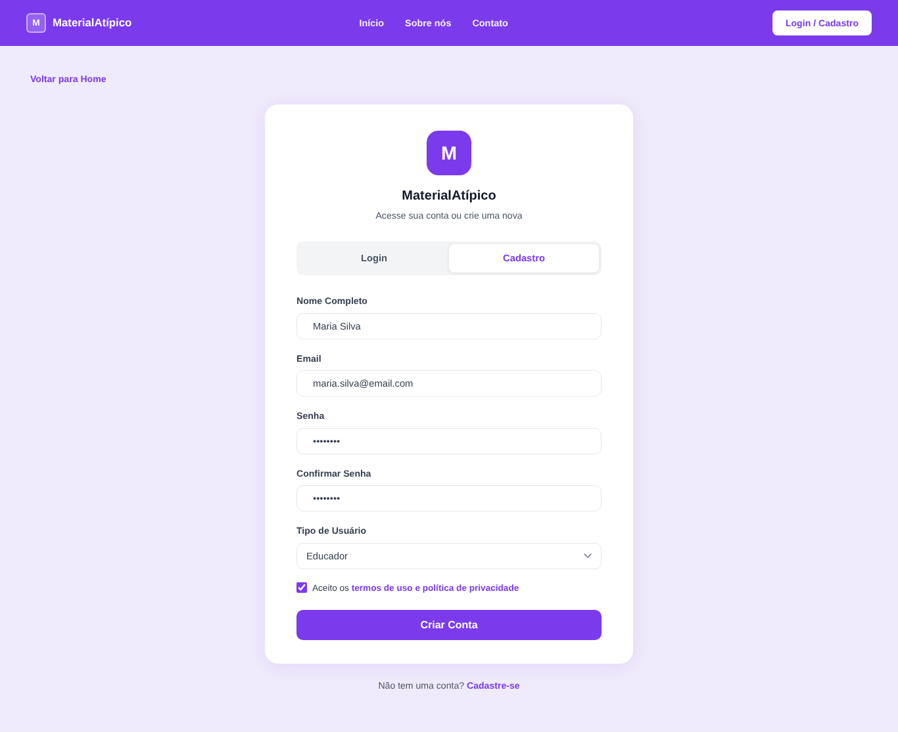

Aba **Cadastro**: valida campos, e-mail, senhas iguais, mínimo de 6 caracteres e aceite dos termos; impede e-mail duplicado e cria o usuário com `notificacoes` padrão.

**Código:** [`paginas/login.html`](../frontend/paginas/login.html) · [`css/login.css`](../frontend/css/login.css) · [`js/sessao.js`](../frontend/js/sessao.js) · [`js/auth.js`](../frontend/js/auth.js)

---

## 6. Home do usuário logado

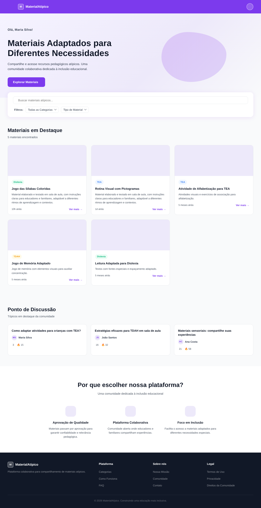

Versão autenticada da home, com avatar/menu do usuário e barra lateral (o item **Admin** só existe para administradores — removido por `sessao.js`). Lista os materiais aprovados.

**Código:** [`paginas/home-logado.html`](../frontend/paginas/home-logado.html) · [`css/home.css`](../frontend/css/home.css) · [`css/home-logado.css`](../frontend/css/home-logado.css) · [`js/sessao.js`](../frontend/js/sessao.js) · [`js/materiais-store.js`](../frontend/js/materiais-store.js) · [`js/home-logado.js`](../frontend/js/home-logado.js)

---

## 7. Biblioteca de materiais

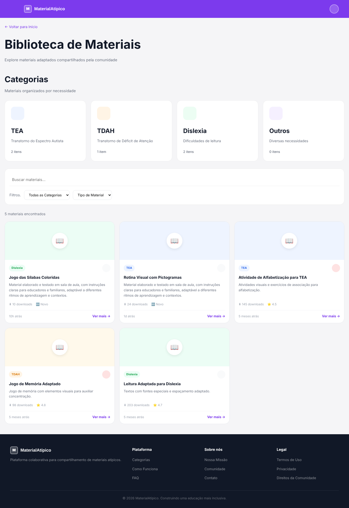

Cards de categoria (TEA, TDAH, Dislexia, Outros) com contadores, busca e filtros por categoria/tipo. Mostra somente materiais com `status = aprovado` (`obterMateriaisPublicos`) e permite favoritar pelo coração do card.

**Código:** [`paginas/material.html`](../frontend/paginas/material.html) · [`css/material.css`](../frontend/css/material.css) · [`js/sessao.js`](../frontend/js/sessao.js) · [`js/materiais-store.js`](../frontend/js/materiais-store.js) · [`js/material.js`](../frontend/js/material.js)

---

## 8. Detalhes do material

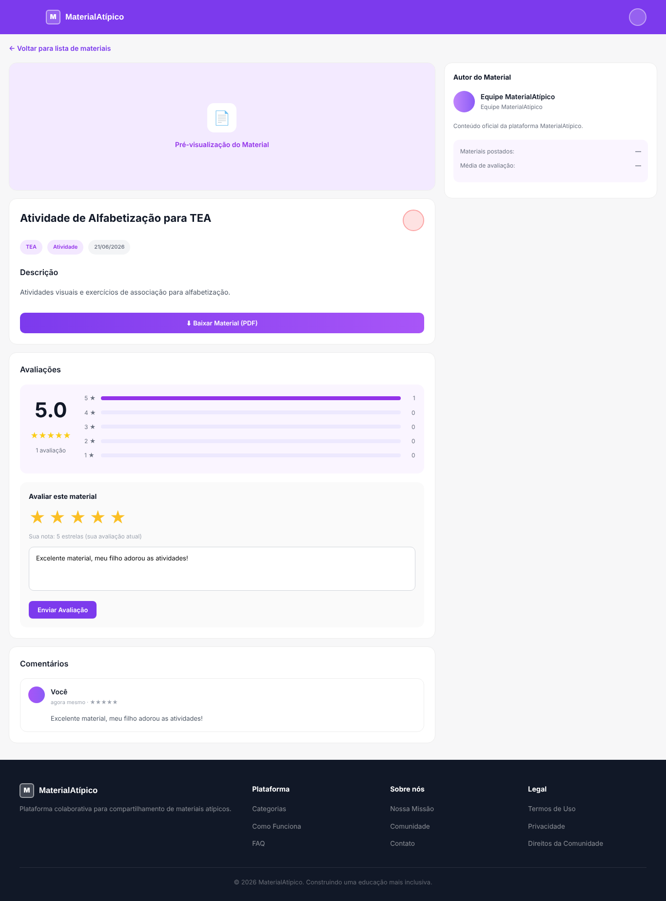

Cabeçalho, descrição, autor, botão de download, **resumo das avaliações** (média e distribuição por estrelas), formulário de avaliação (1 por usuário, a nova substitui a antiga) e comentários. Materiais não aprovados só são vistos pelo dono ou admin.

**Código:** [`paginas/detalhesMaterial.html`](../frontend/paginas/detalhesMaterial.html) · [`css/detalhesMaterial.css`](../frontend/css/detalhesMaterial.css) · [`js/sessao.js`](../frontend/js/sessao.js) · [`js/materiais-store.js`](../frontend/js/materiais-store.js) · [`js/detalhesMaterial.js`](../frontend/js/detalhesMaterial.js)

---

## 9. Criar material

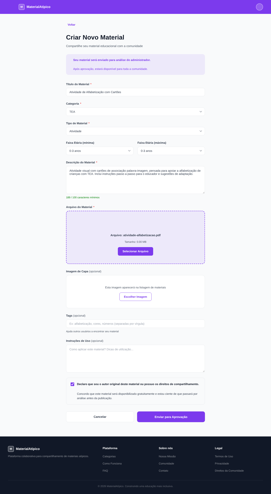

Formulário com título, categoria, tipo, faixa etária, descrição (mín. 100 caracteres, com contador), upload por clique ou arrastar-e-soltar, capa opcional com pré-visualização e declaração de autoria. Ao enviar, o material é salvo com `status = pendente`.

**Código:** [`paginas/criar.html`](../frontend/paginas/criar.html) · [`css/criar.css`](../frontend/css/criar.css) · [`js/sessao.js`](../frontend/js/sessao.js) · [`js/materiais-store.js`](../frontend/js/materiais-store.js) · [`js/criar.js`](../frontend/js/criar.js)

---

## 10. Meus materiais

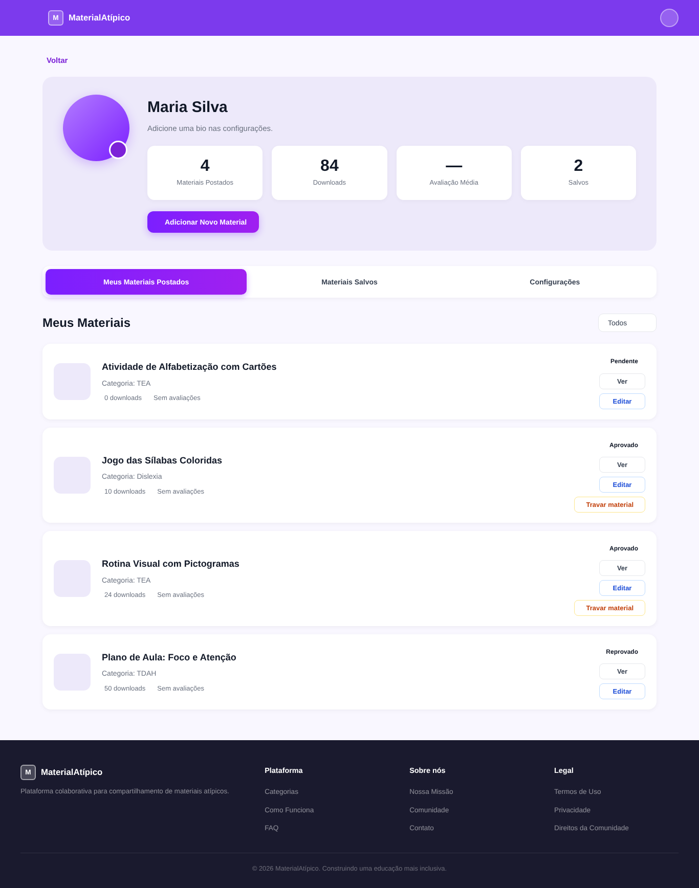

Lista dos materiais do usuário com estatísticas e **status** (Aprovado, Pendente, Reprovado, Bloqueado), filtros e botão **Editar**. Aqui aparecem o material recém-enviado (pendente) e os demais.

**Código:** [`paginas/meus-materiais.html`](../frontend/paginas/meus-materiais.html) · [`css/home.css`](../frontend/css/home.css) · [`css/home-logado.css`](../frontend/css/home-logado.css) · [`css/meuperfil.css`](../frontend/css/meuperfil.css) · [`js/sessao.js`](../frontend/js/sessao.js) · [`js/materiais-store.js`](../frontend/js/materiais-store.js) · [`js/meus_materiais.js`](../frontend/js/meus_materiais.js)

---

## 11. Editar material

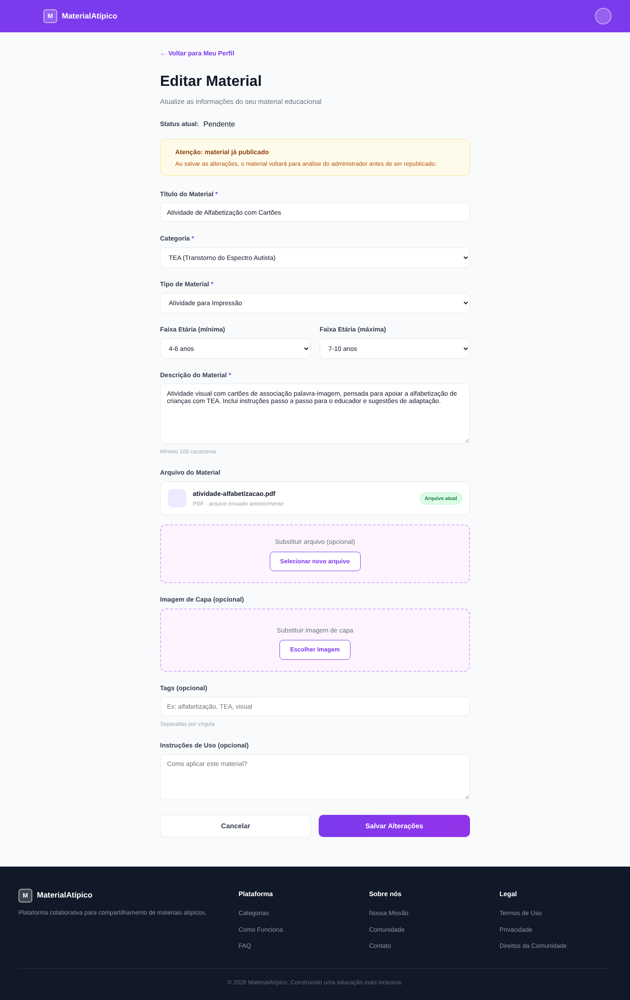

Formulário pré-preenchido. Só o dono (ou admin) acessa; ao salvar, o material **volta para `pendente`** e é reavaliado (`editarMaterialStore`). Material já publicado exibe aviso antes de editar.

**Código:** [`paginas/editarMaterial.html`](../frontend/paginas/editarMaterial.html) · [`css/editarMaterial.css`](../frontend/css/editarMaterial.css) · [`js/sessao.js`](../frontend/js/sessao.js) · [`js/materiais-store.js`](../frontend/js/materiais-store.js) · [`js/editarMaterial.js`](../frontend/js/editarMaterial.js)

---

## 12. Perfil

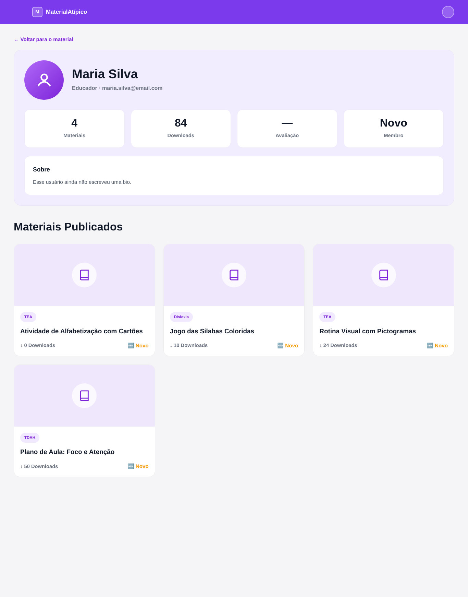

Dados do usuário (nome, tipo, bio), estatísticas calculadas (materiais, downloads, avaliação média) e grade com os materiais publicados.

**Código:** [`paginas/perfil.html`](../frontend/paginas/perfil.html) · [`css/perfil.css`](../frontend/css/perfil.css) · [`js/sessao.js`](../frontend/js/sessao.js) · [`js/materiais-store.js`](../frontend/js/materiais-store.js) · [`js/perfil.js`](../frontend/js/perfil.js)

---

## 13. Materiais salvos

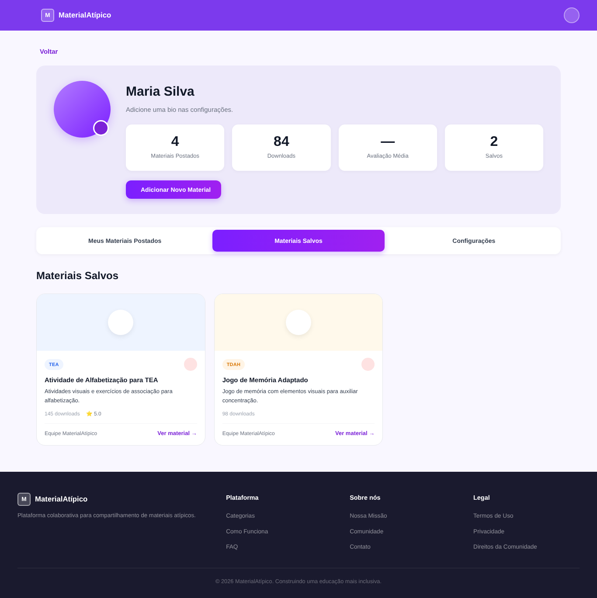

Aba do perfil com os materiais favoritados pelo usuário (`materialatipico:favoritos`). O botão de coração remove o favorito.

**Código:** [`paginas/materiais-salvos.html`](../frontend/paginas/materiais-salvos.html) · [`css/home.css`](../frontend/css/home.css) · [`css/home-logado.css`](../frontend/css/home-logado.css) · [`css/meuperfil.css`](../frontend/css/meuperfil.css) · [`js/sessao.js`](../frontend/js/sessao.js) · [`js/materiais-store.js`](../frontend/js/materiais-store.js) · [`js/materiais-salvos.js`](../frontend/js/materiais-salvos.js)

---

## 14. Configurações da conta

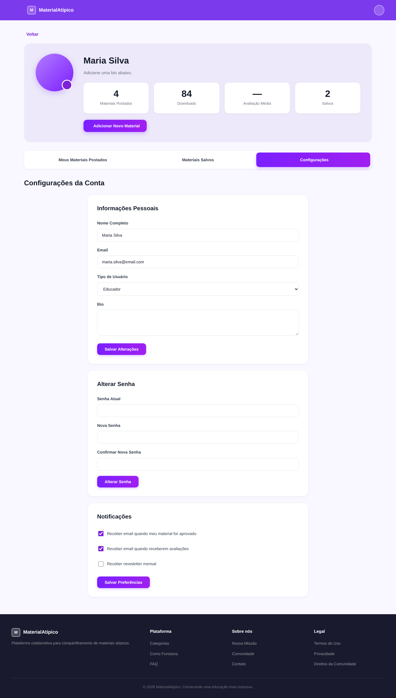

Edição de informações pessoais e bio, **troca de senha** (confere a senha atual, mínimo 6) e preferências de notificação. Atualiza `ma_usuarios` e a sessão via `atualizarUsuarioLogado`.

**Código:** [`paginas/configuracoes.html`](../frontend/paginas/configuracoes.html) · [`css/meuperfil.css`](../frontend/css/meuperfil.css) · [`js/sessao.js`](../frontend/js/sessao.js) · [`js/materiais-store.js`](../frontend/js/materiais-store.js) · [`js/configuracoes.js`](../frontend/js/configuracoes.js)

---

## 15. Painel admin — Materiais

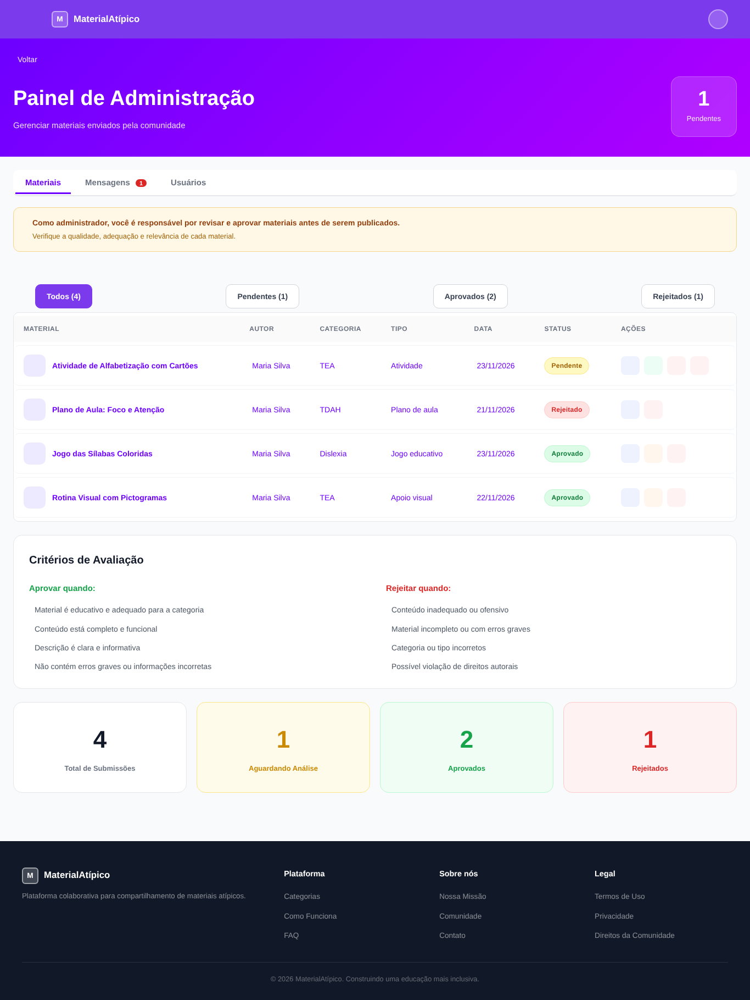

Acesso restrito (`ehAdmin()`). Fila de moderação com filtros e contadores; ações por linha: visualizar, **aprovar**, **rejeitar**, **bloquear/desbloquear** e **excluir**.

**Código:** [`paginas/admin.html`](../frontend/paginas/admin.html) · [`css/admin.css`](../frontend/css/admin.css) · [`js/sessao.js`](../frontend/js/sessao.js) · [`js/materiais-store.js`](../frontend/js/materiais-store.js) · [`js/admin.js`](../frontend/js/admin.js)

---

## 16. Painel admin — Mensagens

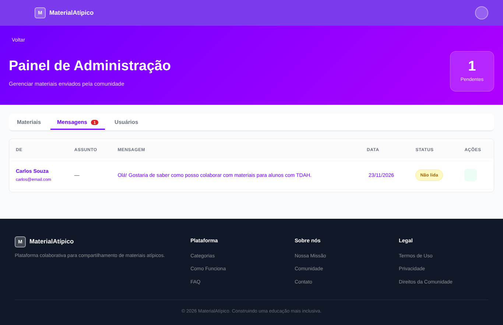

Caixa de entrada das mensagens enviadas em Contato, com selo de não lidas e ação **marcar como lida**.

**Código:** [`paginas/admin.html`](../frontend/paginas/admin.html) · [`css/admin.css`](../frontend/css/admin.css) · [`js/admin.js`](../frontend/js/admin.js) · [`js/contato.js`](../frontend/js/contato.js)

---

## 17. Painel admin — Usuários

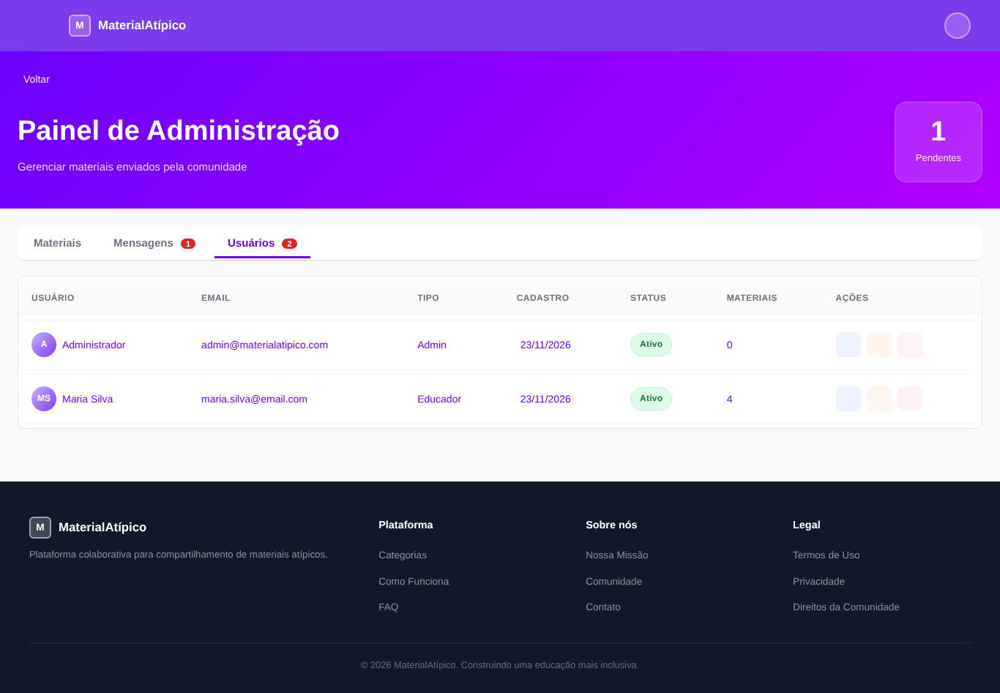

Lista de contas com tipo, data de cadastro, status e total de materiais; ações **ver perfil** (modal), **bloquear/desbloquear** (impede o login) e **excluir conta**.

**Código:** [`paginas/admin.html`](../frontend/paginas/admin.html) · [`css/admin.css`](../frontend/css/admin.css) · [`js/sessao.js`](../frontend/js/sessao.js) · [`js/admin.js`](../frontend/js/admin.js)

---

## 18. Revisão de material (admin)

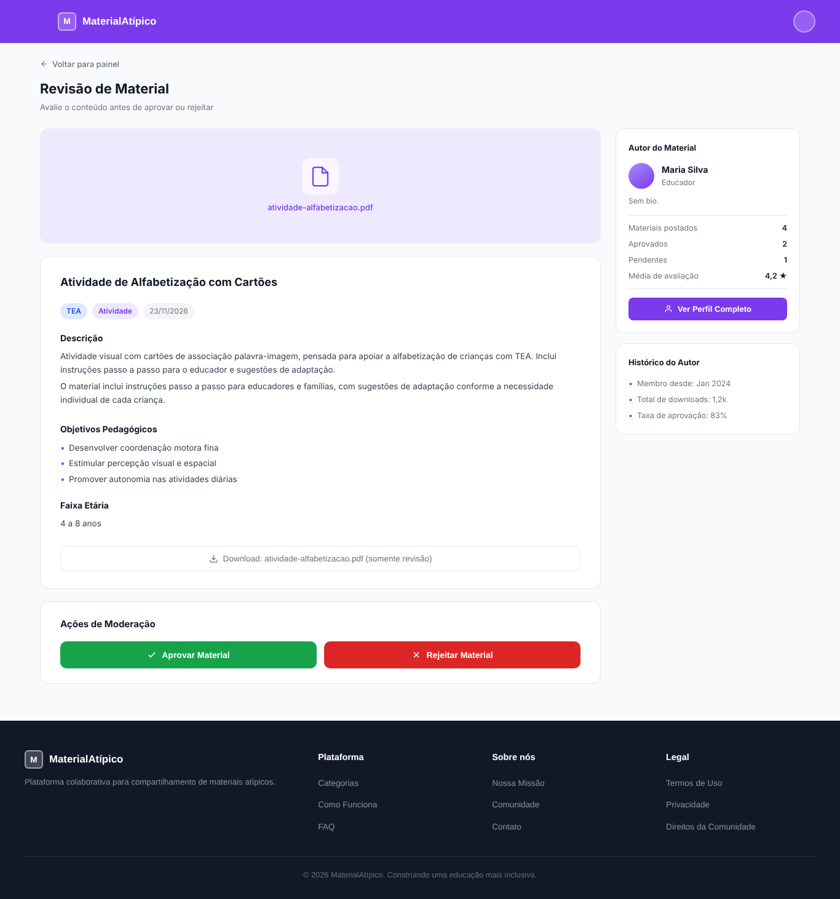

Detalhe do material enviado, dados e estatísticas do autor, pré-visualização do arquivo e botões **Aprovar** / **Rejeitar** com modal de confirmação e toast. Após decidir, retorna ao painel.

**Código:** [`paginas/adminrevisao.html`](../frontend/paginas/adminrevisao.html) · [`css/adminrevisao.css`](../frontend/css/adminrevisao.css) · [`js/sessao.js`](../frontend/js/sessao.js) · [`js/materiais-store.js`](../frontend/js/materiais-store.js) · [`js/adminrevisao.js`](../frontend/js/adminrevisao.js)

---

